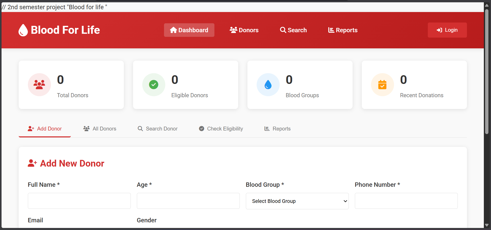
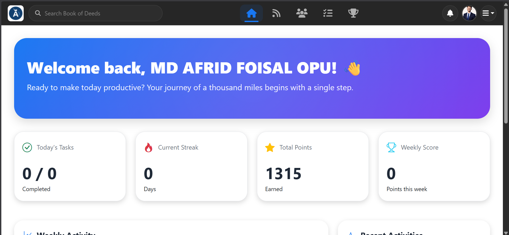
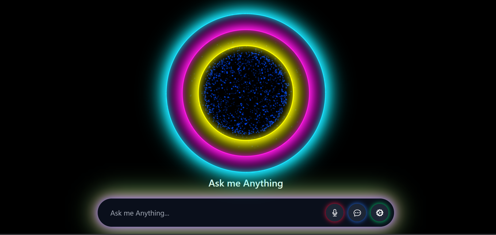

# Afrid 3D Portfolio

Premium developer portfolio for **Md Afrid Foisal Opu**, built to present frontend engineering, product thinking, and polished interactive work in a recruiter-friendly format.

[](https://react.dev/)
[](https://vite.dev/)
[](https://docs.pmnd.rs/react-three-fiber)
[](https://tailwindcss.com/)
[](https://www.framer.com/motion/)
[](https://vercel.com/)

## Live Demo

**Portfolio:** [afrid-3d-portfolio.vercel.app](https://afrid-3d-portfolio.vercel.app)

## Preview

| Blood For Life | Bookeeds | AI Controller for PC |
| --- | --- | --- |
|  |  |  |

## What This Portfolio Communicates

- Clear frontend/product positioning within the first viewport.
- Recruiter-ready calls to action for projects, contact, and resume download.
- Responsive UI with semantic sections, readable hierarchy, and accessible focus states.
- 3D and motion used as atmosphere, not as visual noise.
- Project cards that prioritize context, tech stack, source code, and live demos.

## Tech Stack

- **Frontend:** React 19, Vite, React Router
- **3D:** Three.js, React Three Fiber, Drei
- **Motion:** Framer Motion
- **Styling:** Tailwind CSS
- **Forms:** EmailJS
- **Deployment:** Vercel

## Getting Started

### Prerequisites

- Node.js 20 or newer
- npm 10 or newer

### Installation

```bash
npm install
```

### Development

```bash
npm run dev
```

Open the local URL Vite prints in the terminal, usually `http://localhost:5173`.

### Production Build

```bash
npm run build
```

### Preview Production Build

```bash
npm run preview
```

### Lint

```bash
npm run lint
```

## Project Structure

```text
src/
  assets/          Static images and technology icons
  components/      Portfolio sections and canvas experiences
  constants/       Site content, navigation, projects, and profile data
  hoc/             Section wrapper for consistent layout and reveals
  hooks/           Responsive behavior helpers
  utils/           Motion variants
public/
  cv/              Downloadable resume/CV files
  desktop_pc/      3D desktop model
  planet/          3D planet model
```

## Deployment

The project is configured for Vercel. Build output is generated by Vite, and `vercel.json` adds security and cache headers for public assets.

## Contact

- **Email:** [25afridfoisal00@gmail.com](mailto:25afridfoisal00@gmail.com)
- **GitHub:** [github.com/Afrid25](https://github.com/Afrid25)
- **Portfolio:** [afrid-3d-portfolio.vercel.app](https://afrid-3d-portfolio.vercel.app)
